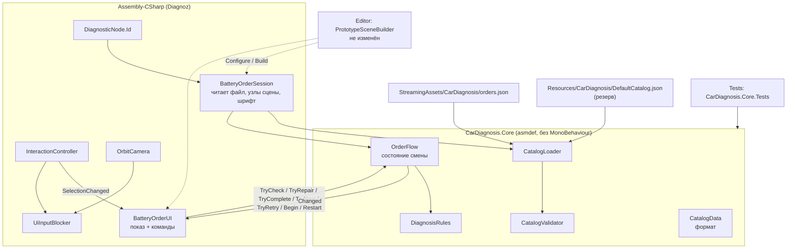
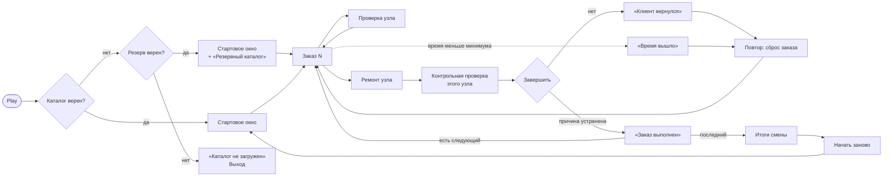
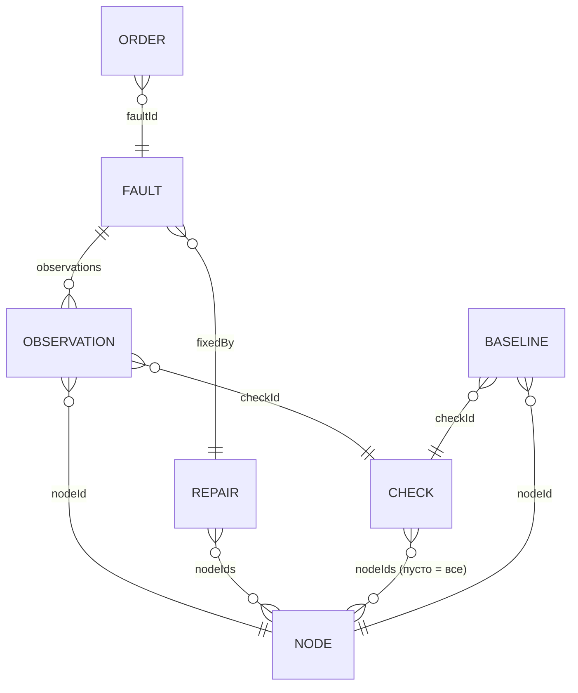

# Архитектура 1.0 RC1 (фактическая)

Схемы — Mermaid (редактируемый текст; открываются в GitHub, VS Code с расширением Mermaid, mermaid.live).

## Слои

Кто за что отвечает:
- `CatalogData` — только поля формата JSON.
- `CatalogValidator` — полная проверка каталога; возвращает список ошибок, ничего не меняет.
- `CatalogLoader` — разбор основного файла → проверка → либо основной целиком, либо резервный целиком (тоже после проверки), либо ничего.
- `DiagnosisRules` — без состояния: какой текст покажет проверка, верен ли ремонт, допустим ли он на узле, минимальный путь.
- `OrderFlow` — единственное место, где меняется состояние: время, ремонты, контроль, исход, попытки, фазы Intro/Order/Final.
- `BatteryOrderSession` — MonoBehaviour-связка: путь к файлу, `Resources`, список узлов сцены, проверка глифов шрифта, логирование.
- `BatteryOrderUI` — строит кнопки из каталога и показывает состояние; правил не содержит (доступность кнопок спрашивает у `OrderFlow`).

## Поток игры

## Схема данных

Выбор наблюдения: если причина заказа ещё не устранена — `fault.observations`; после верного ремонта — `fixedHeadline/fixedText`
этой записи; иначе нормальная картина `baseline`; иначе нейтральный текст проверки (`{node}` → имя узла).

## Что сознательно не сделано
- Нет универсального движка механик: новые узлы сцены и новые типы взаимодействий требуют Unity и C#.
- Нет симуляции электросистемы, разряда во времени, ожидания; наблюдения — заданные тексты.
- Нет сохранений, магазина, экономики, новых машин.
